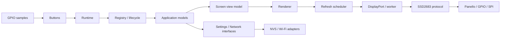

# Architecture

## Dependency direction

The portable component includes no ESP-IDF, FreeRTOS, serial access, global board
singleton, or wall-clock dependency. Hardware ownership is composed in `app_main`.

| Module | Responsibility and boundary |
| --- | --- |
| `Board` | NOTE4C pin map, power latch, buttons, charge status, read-only RTC, raw battery ADC; no app state |
| `Buttons` | Deterministic sample-to-event decoder with injected monotonic timestamps |
| `Runtime` | Single owner of model state, service dispatch, persistence debounce and rendering requests |
| Application registry | Up to eight apps, unique IDs, immutable registration after start, enter/leave on navigation |
| `Application` | Lifecycle, button and tick handlers, semantic `Screen`; no framebuffer or device calls |
| `ScreenRenderer` / `Frame` | Pure clipped 2-bpp raster operations; minimal replaceable ASCII typography |
| `DisplayScheduler` | Coalescing, deduplication, ownership and fault policy |
| `DisplayPort` | Asynchronous full-refresh job submission and completion polling |
| `Ssd2683` / `PanelIo` | Portable protocol and hardware transport; one display worker owns all panel I/O |
| `SettingsStore` | Versioned settings via one atomic NVS blob in namespace `note4c_fw` |
| `Network` | Connection requests and observable state; IDF callbacks update atomics, never app objects |
| `PowerPolicy` | Pure sleep eligibility; board adapter performs the optional sleep transition |

## Rendering on a slow display

The hardware capability is **full refresh only**. Dirty rectangles can later reduce
raster work, but do not imply a faster physical update. There are no animation,
blinking cursor, spinner or seconds-ticking clock refreshes. The example reports
work through the LED and logs.

There are three scheduler-owned 30,000-byte frames: desired, in-flight, and last
successfully presented. The runtime owns a fourth render buffer. Total pixel storage
is 120,000 bytes; firmware allocates the enclosing engine in PSRAM. The in-flight
buffer never changes until the worker reports completion. The driver copies only
100 bytes at a time to an internal, aligned SPI staging buffer.

Applications update the model immediately. Changed view models render to RAM; exact
byte comparison suppresses identical physical frames without relying on hash
collisions. Submit replaces the desired frame, so an input burst cannot create a
queue of stale full-screen refreshes. A request that returns to the visible image
needs no update. A request made while busy is compared with the actual completed
in-flight image, preserving the latest state even if it equals the image from before
the current refresh.

Default timing is 600 ms quiet coalescing, a 2,000 ms maximum hold under continuing
changes, and a 3,000 ms cooldown after completion. The latter two rules do not
interrupt an active panel waveform or override BUSY. Maximum coalescing prevents
continuous input from postponing the next eligible refresh indefinitely. These are
policy defaults for validation, not panel temperature/refresh specifications.

The UI task samples input every 20 ms. The display worker blocks independently on
panel BUSY, yielding between checks. There is one outstanding job, a one-slot queue,
and an atomic completion state; input never waits on that queue. The scheduler alone
submits jobs. Logical navigation can advance ahead of what is visible; applications
must avoid destructive blind actions. A future confirmation UI should arm actions
only after the relevant frame has actually completed.

Protocol errors or BUSY timeouts abort the remaining command sequence and remove
panel power. An unsuccessful transfer invalidates the known physical image; it is
never recorded as successfully presented. The scheduler latches a fault. Long Up
requests a full retry; no repeated automatic refresh storm occurs. Per-stage BUSY
timeout is 120 seconds, inherited conservatively from the reference; actual duration,
temperature limits and recovery still require hardware testing.

## Lifecycle and services

Apps live as long as the runtime. `begin()` loads settings and enters the first app.
Short Confirm calls leave/enter to cycle through the registry. Other events route
to the active app. Tick handlers should only advance state or inspect service results.
No app method runs in an ISR, Wi-Fi event callback or display worker.

Settings are a little-endian schema/counter blob committed to NVS as a unit. Saves
occur after one second without a model settings change; unchanged values cause no
write. Failed saves leave changes dirty and retries are limited to once per second.
Unknown schemas or load errors disable writes for that boot to preserve existing
data. No automatic erase, downgrade or migration is performed. Add explicit versioned
migrations before changing the schema. On NVS failure the application can still run
with in-memory defaults, with an error reported in logs.

Wi-Fi is optional, station-only and off at boot. `connect()` accepts runtime strings;
the driver uses RAM credential storage. It accepts open networks or WPA2/WPA3-capable
networks with 8–63-character passphrases; 64-character raw PSKs are not supported.
There is no credential provisioning/storage UI or TLS application client yet. A failed
connection is observable; the caller must stop it and decide when to retry. Another
connection can start only after the asynchronous `Stopping` state reaches `Off`,
so stale stop/disconnect events do not race a new attempt. A future
HTTP client must validate server certificates. Keep network I/O outside app callbacks.

Sleep requires an idle model, released buttons, settled display, clean settings,
network off, no charging and no fault. Deep sleep is disabled by default. The optional
path holds GPIO17 high, keeps panel/audio rails off, and uses low GPIO0 or GPIO18 wake.
GPIO39 cannot wake this deep-sleep configuration. Physical latch/wake behavior and
current draw have not been validated; no battery-life claim is made. Power-latch
shutdown and automatic storage erasure are not implemented.

## Extension boundaries

RawDraw can replace `ScreenRenderer` through a pure adapter writing into `Frame`.
Import primitives and selected widgets with their notices, not the upstream page
manager or its refresh scheduler. Keep this scheduler as the sole refresh authority.
For richer apps, replace the small `Screen` with typed view models without giving
domain models access to the framebuffer.

RTC access currently only reads PCF8563 time (2000–2099 policy, low-voltage and basic
BCD/range checks); it never sets the clock or configures alarms. Battery sampling
reports raw ADC counts, without an invented percentage or divider ratio. Future
clock and battery services should inject fakes in host tests.

Audio should have an asynchronous `AudioService` with start/stop and completion
events, owning ES8311/I2S and amplifier power as one unit. Microphone and speaker
pins are documented by the vendor; audio rails stay off in this baseline. NFC is
also deferred and must not share the I2C bus without explicit ownership. These
features can be added without changing application navigation or display policy.
